# FARHORIZON

A compact, atmospheric 3D space sandbox running on a **purpose-built engine** (C++20, SDL3, Vulkan 1.3).
It does not use an existing game engine. See `docs/STATUS.md` for what works today.

**Stage 6: combat and contracts.** Rust Jackal raiders hunt the deep side of the Cinder Drift.
Take a bounty, a courier run or a refinery order, then spend the pay at the shipyard.

| Skirmish in the Cinder Drift (cockpit) | Contract board | Shipyard |
|---|---|---|
| 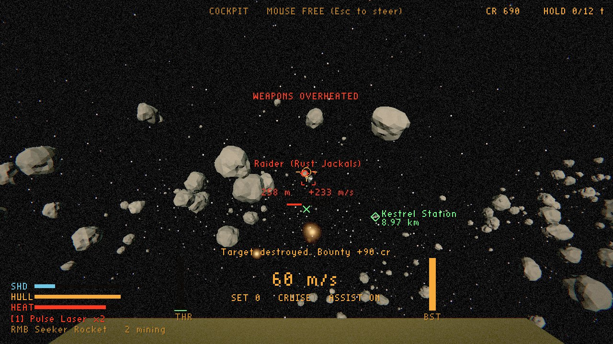 | 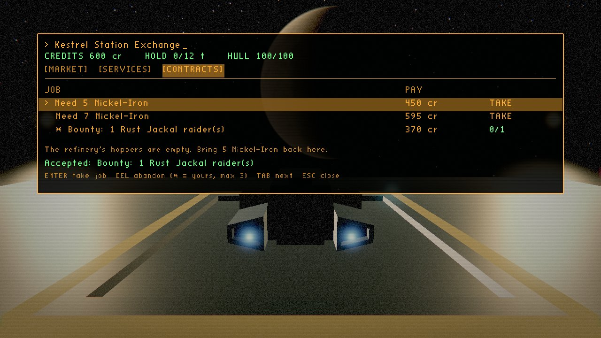 | 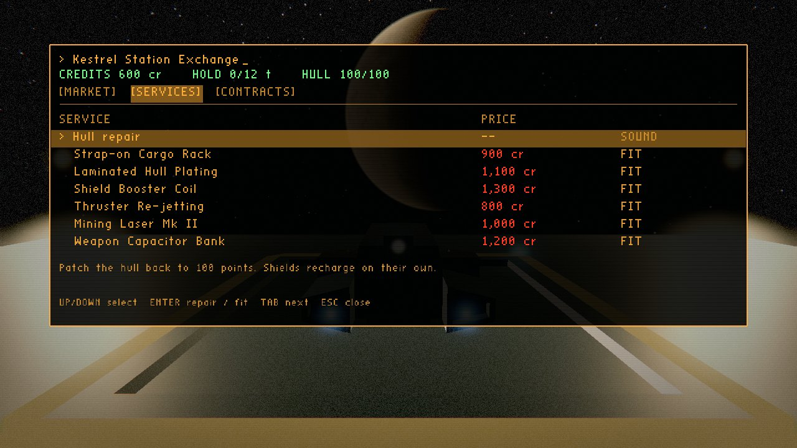 |

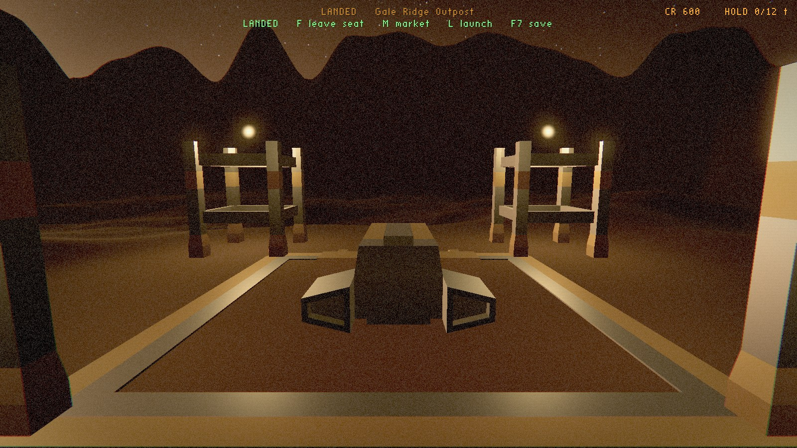

| Varga from orbit | Re-entry | On foot at Gale Ridge |
|---|---|---|
| 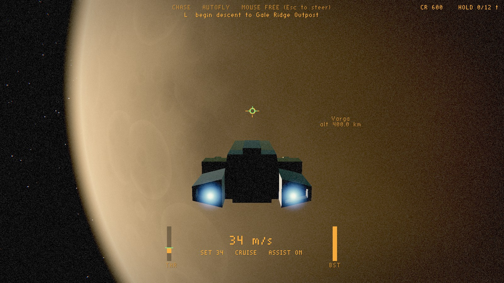 | 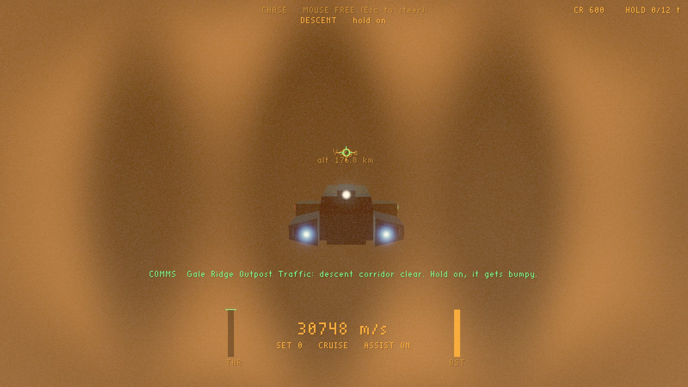 | 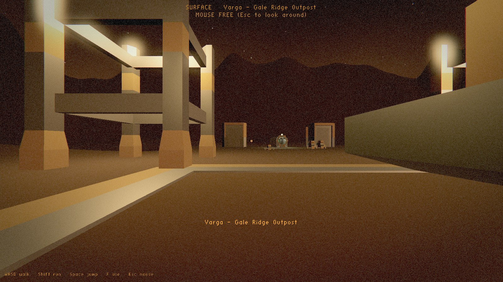 |

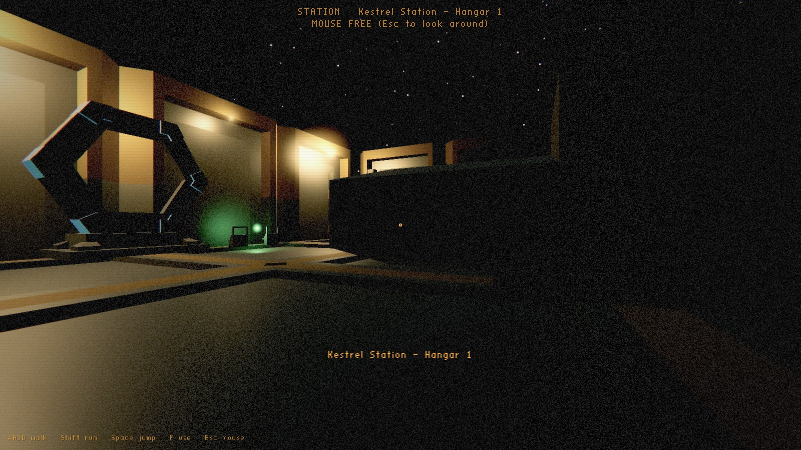

| Mining | Station exchange terminal | Sparrow cabin |
|---|---|---|
| 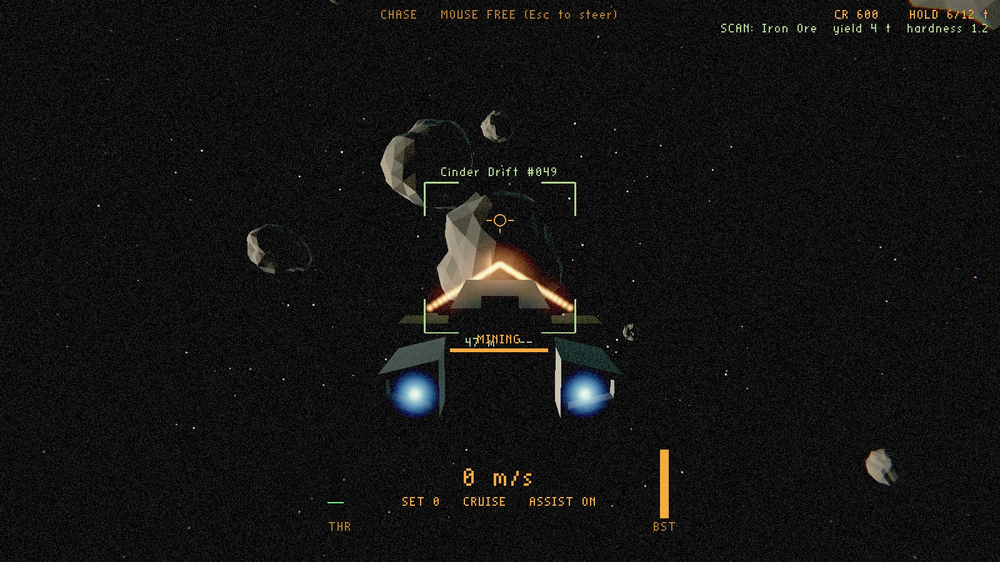 | 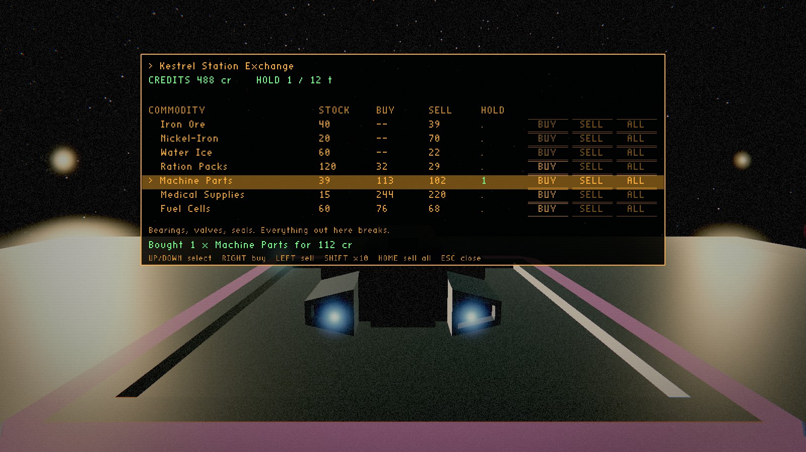 | 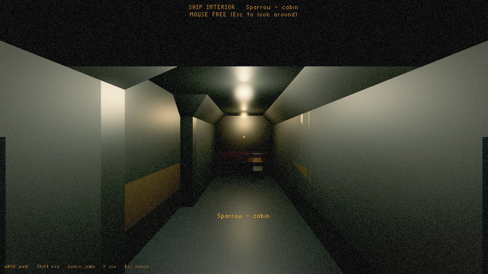 |

Docking and earlier stages:

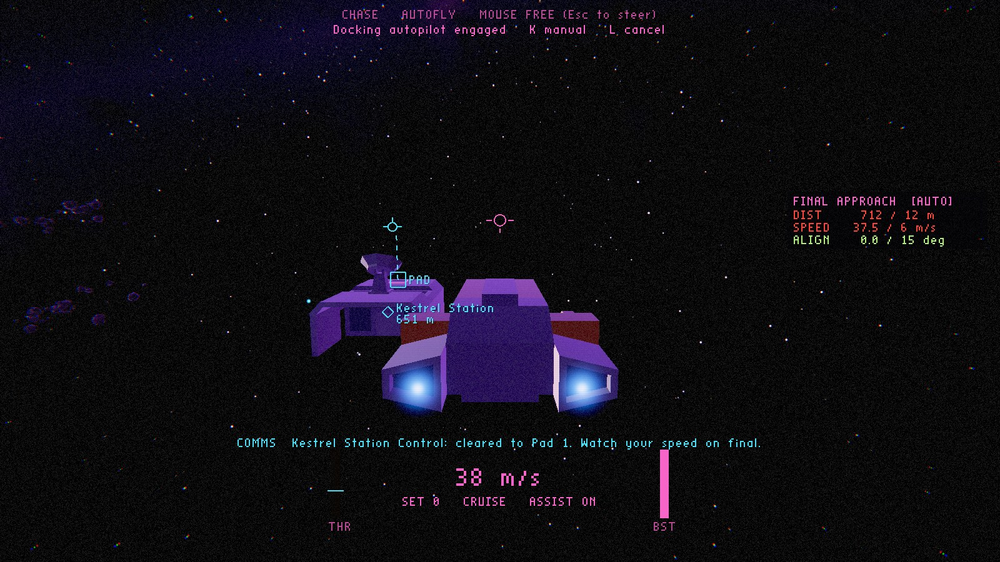

| Docked on the pad | Sparrow cabin | Kestrel hangar |
|---|---|---|
| 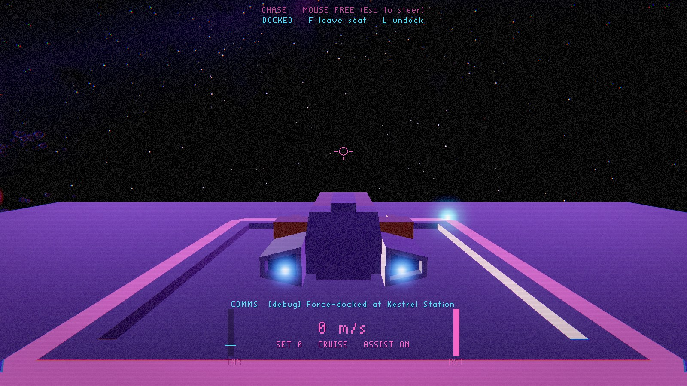 | 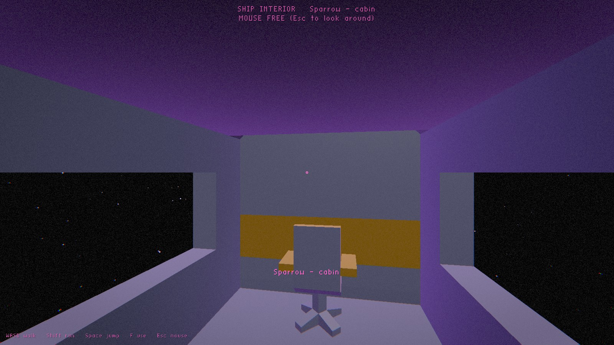 | 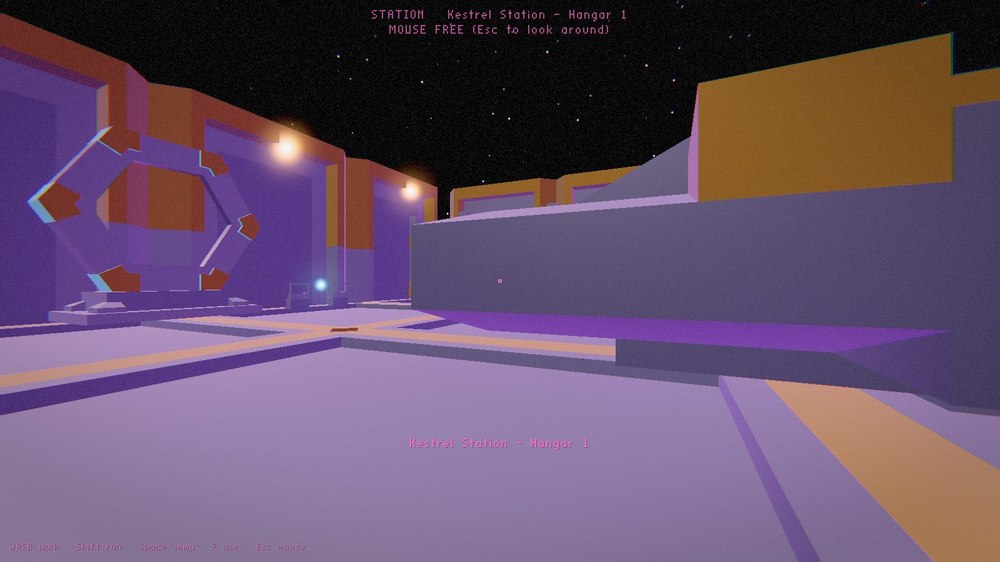 |

| Retro 80s look (default) | Clean look (F4) |
|---|---|
| 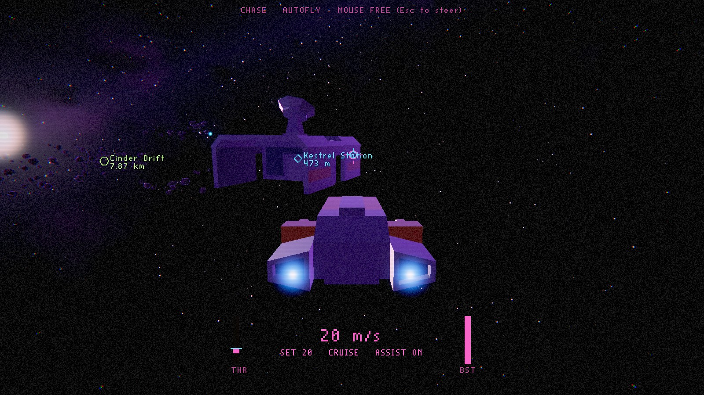 | 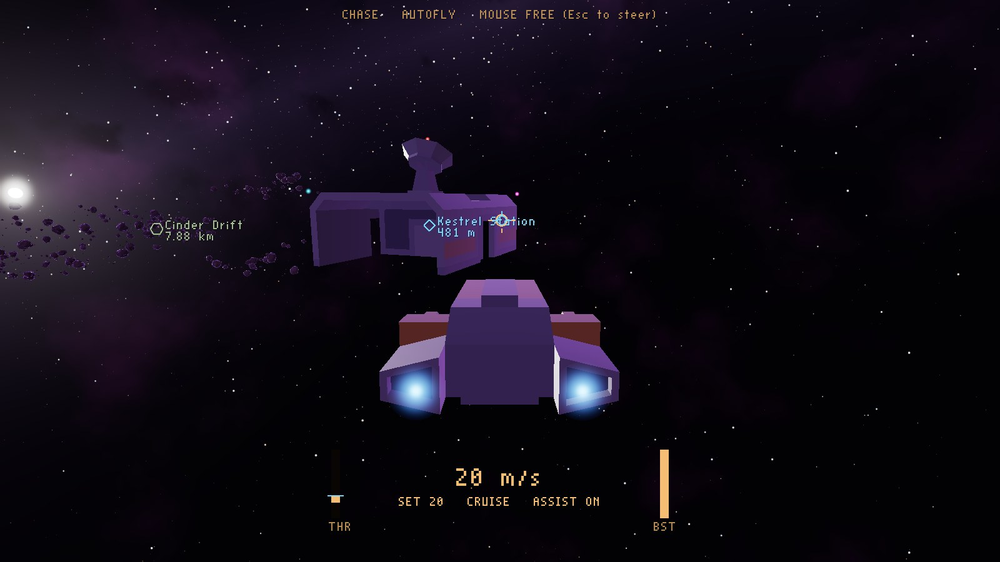 |

## Quick start

Requirements: CMake ≥ 3.24, a C++20 compiler (MSVC 2022 / GCC 13 / Clang 17), the Vulkan SDK
(headers, loader, `glslangValidator`), Git (SDL3 is fetched at configure time).

```bash
cmake -S . -B build -DCMAKE_BUILD_TYPE=Release
cmake --build build --config Release
ctest --test-dir build -C Release
```

Run `build/farhorizon` (on Windows: `build\Release\farhorizon.exe`). Full instructions,
including headless runs and benchmarks, are in [`docs/BUILDING.md`](docs/BUILDING.md).

## Controls

| Key | Action |
|---|---|
| Mouse (captured) | virtual stick: pitch / yaw. **Esc** frees or captures the mouse |
| Arrow keys | pitch / yaw |
| W / S | throttle up / down (assist on). Main engine / retro (assist off) |
| X | full stop: brakes to a standstill and holds there until you touch a flight control |
| A / D, Space / Left Ctrl | strafe left / right, up / down |
| Q / E | roll |
| Left Shift | boost (energy limited; release and press again after it runs out) |
| Z | flight assist on / off |
| B | precision (docking) speed mode |
| C | recentre the virtual stick |
| T / G / Backspace | next target / nearest asteroid / clear target |
| 1 / 2 | weapon selector: guns / mining laser |
| LMB | fire the selected system (guns, or the mining laser; Left Alt always mines) |
| RMB (or H) | seeker rocket (homes on your locked ship target) |
| Y | target the nearest hostile ship (lead pip shows where to aim) |
| R | scan the targeted asteroid (resource, yield, hardness) |
| M | terminal while docked or landed (also F at a terminal): MARKET / SERVICES / CONTRACTS, Tab switches |
| F7 / F8 | quicksave / load (`saves/`); autosave on every docking |
| N / J | next nav destination / travel drive engage-abort |
| L | contextual: request docking, begin descent (near a site's orbit), launch, undock, cancel |
| K | docking approach autopilot on/off (while cleared) |
| F | interact: leave the pilot seat (docked), airlock, board, terminals |
| V | chase ↔ cockpit camera |
| F2 | developer cameras (orbit → free → back) |
| F1 | developer info overlay |
| F3 | autofly (scripted test flight) |
| F4 | cycle visual look (Used Future ↔ Retro 80s ↔ Clean) |
| F5 | hot-reload content (keeps old content if the new content is invalid) |
| F11 / F12 / F10 | fullscreen / screenshot / quit |

**On foot:** WASD walk, Shift run, Space jump, mouse look, F use.

**Esc** opens the pause menu; **backtick** frees the mouse, and clicking the game window takes it
back. Rebind keys in **Options > Controls** (overrides are saved in `settings.json`; the defaults
are in `content/config/input.json`).

**Try the trade run to Varga:** buy Ration Packs at Kestrel (M), undock (L), press N until
"Gale Ridge Outpost (Varga)" is selected, then J to engage the travel drive. Once you're in orbit,
L begins the descent. Walk to the supply shed (F at the terminal), sell the rations for a
premium, and buy cheap nickel. Board, sit, L to launch, then N/J back to Kestrel.

**Try a mining run:** undock (L), fly to the Cinder Drift asteroid field (8 km, use boost), press
G to target a rock and R to scan it, then hold the left mouse button with the nose on target. Ore
chunks drift into your scoop. Fly back, dock, press M and sell; prices drop as you flood the
market. F7 saves anywhere, F8 loads, and `--continue` resumes the quicksave.

**Try the Stage 3 loop:** fly toward Kestrel Station (3 km ahead) and press **L** for clearance,
then land on the roof pad yourself or press **K**. Once docked, **F** leaves the seat. Walk aft to
the junction and right to the airlock, then **F** steps into the hangar. Walk back to the ship,
press **F** to board, **F** at the seat, and **L** to undock.
Debug shortcuts: `--start-docked`, `--start-landed`, `--start-in ship|station|surface`, F6 force-dock.

## Layout

```
engine/   core, math, platform (SDL3), assets (glTF, images), render (Vulkan), debug
game/     content defs, flight model, world, docking, interiors, character controller, session, cameras, HUD, app
shaders/  GLSL, compiled to SPIR-V at build time
content/  data-driven content: asset manifest, ships, scenes, input bindings, models
tools/    content_validator, asset_tools (GLB repair)
tests/    headless unit tests (no GPU required)
docs/     status, decisions (ADRs), data schemas, reports
```
