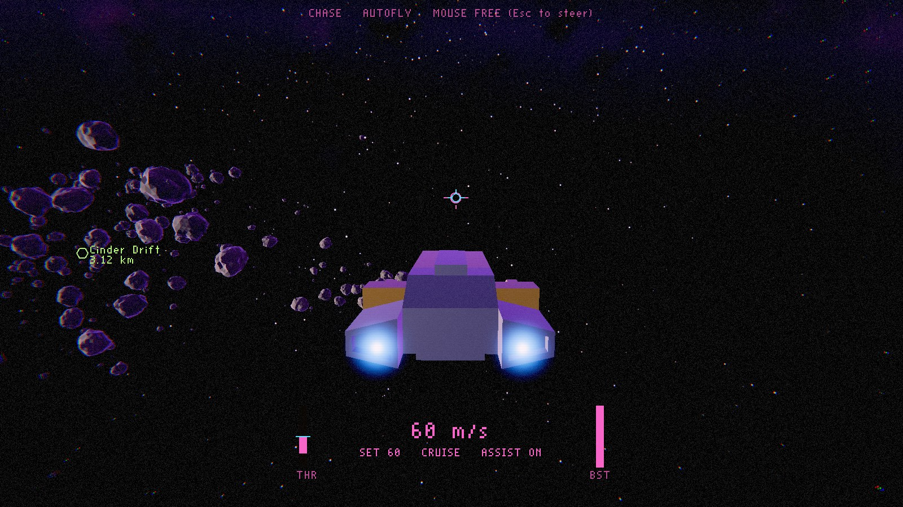

# FARHORIZON

A compact, atmospheric 3D space sandbox running on a **purpose-built engine** (C++20, SDL3, Vulkan 1.3).
It does not use an existing game engine. See `docs/STATUS.md` for what works today.


| Retro 80s look (default) | Clean look (F4) |
|---|---|
|  |  |

## Quick start

Requirements: CMake ≥ 3.24, a C++20 compiler (MSVC 2022 / GCC 13 / Clang 17), the Vulkan SDK
(headers, loader, `glslangValidator`), Git (SDL3 is fetched at configure time).

```bash
cmake -S . -B build -DCMAKE_BUILD_TYPE=Release
cmake --build build --config Release
ctest --test-dir build -C Release
```

Run `build/farhorizon` (on Windows: `build\Release\farhorizon.exe`). Full instructions,
including headless runs and benchmarks, are in [`docs/BUILDING.md`](docs/BUILDING.md).

## Controls (Stage 2 flight)

| Key | Action |
|---|---|
| Mouse (captured) | virtual stick: pitch / yaw. **Esc** frees or captures the mouse |
| Arrow keys | pitch / yaw |
| W / S | throttle up / down (assist on). Main engine / retro (assist off) |
| X | zero throttle |
| A / D, Space / Left Ctrl | strafe left / right, up / down |
| Q / E | roll |
| Left Shift | boost (energy limited; release and press again after it runs out) |
| Z | flight assist on / off |
| B | precision (docking) speed mode |
| C | recentre the virtual stick |
| T / G / Backspace | next target / nearest asteroid / clear target |
| V | chase ↔ cockpit camera |
| F2 | developer cameras (orbit → free → back) |
| F1 | developer info overlay |
| F3 | autofly (scripted test flight) |
| F4 | cycle visual look (Retro 80s ↔ Clean) |
| F5 | hot-reload content (keeps old content if the new content is invalid) |
| F11 / F12 / F10 | fullscreen / screenshot / quit |

All bindings and mouse settings live in `content/config/input.json`.

## Layout

```
engine/   core, math, platform (SDL3), assets (glTF, images), render (Vulkan), debug
game/     content definitions, flight model, world (asteroids, props, collisions), cameras, HUD, app
shaders/  GLSL, compiled to SPIR-V at build time
content/  data-driven content: asset manifest, ships, scenes, input bindings, models
tools/    content_validator, asset_tools (GLB repair)
tests/    headless unit tests (no GPU required)
docs/     status, decisions (ADRs), data schemas, reports
```
