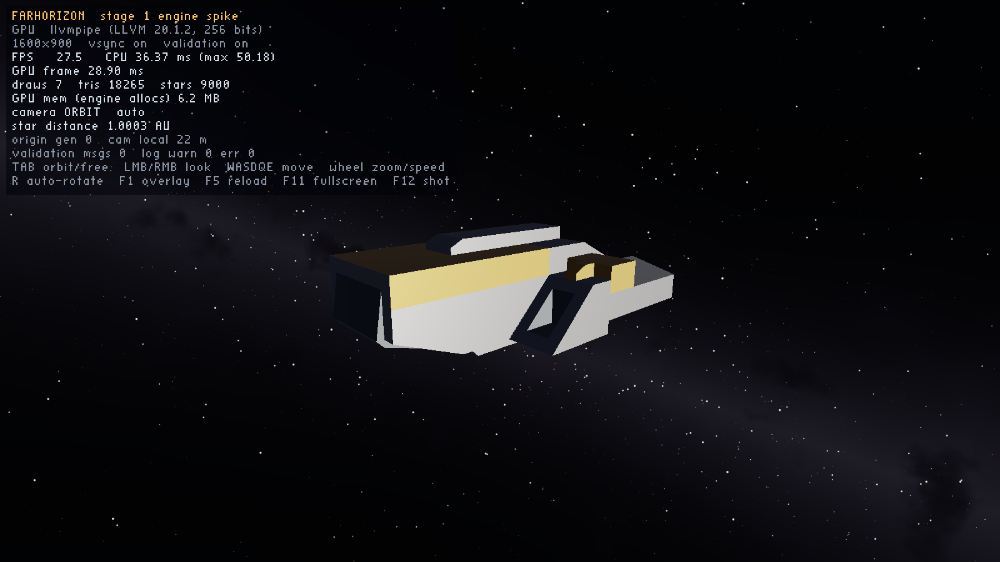

# FARHORIZON

A compact, atmospheric 3D space sandbox running on a **purpose-built engine** (C++20, SDL3, Vulkan 1.3).
It does not use an existing game engine. See `docs/STATUS.md` for what works today.



## Quick start

Requirements: CMake ≥ 3.24, a C++20 compiler (MSVC 2022 / GCC 13 / Clang 17), the Vulkan SDK
(headers, loader, `glslangValidator`), Git (SDL3 is fetched at configure time).

```bash
cmake -S . -B build -DCMAKE_BUILD_TYPE=Release
cmake --build build --config Release
ctest --test-dir build -C Release
```

Run `build/farhorizon` (on Windows: `build\Release\farhorizon.exe`). Full instructions,
including headless runs and benchmarks, are in [`docs/BUILDING.md`](docs/BUILDING.md).

## Controls (Stage 1 developer camera)

| Key | Action |
|---|---|
| Tab | toggle orbit / free-fly camera |
| LMB/RMB drag | orbit, or look around (free mode: RMB) |
| W A S D / Q E | move (free mode), Shift = ×10 boost |
| Mouse wheel | zoom (orbit) / speed (free) |
| R | toggle auto-rotate |
| F1 | developer overlay |
| F5 | hot-reload content (keeps old content if the new one is invalid) |
| F11 | fullscreen (borderless) |
| F12 | screenshot to `screenshots/` |
| Esc | quit |

Bindings live in `content/config/input.json`.

## Layout

```
engine/   core, math, platform (SDL3), assets (glTF, images), render (Vulkan), debug
game/     content definitions (ship/scene), dev camera, Stage 1 showcase app
shaders/  GLSL, compiled to SPIR-V at build time
content/  data-driven content: asset manifest, ships, scenes, input bindings, models
tools/    content_validator
tests/    headless unit tests (no GPU required)
docs/     status, decisions (ADRs), data schemas, reports
```
